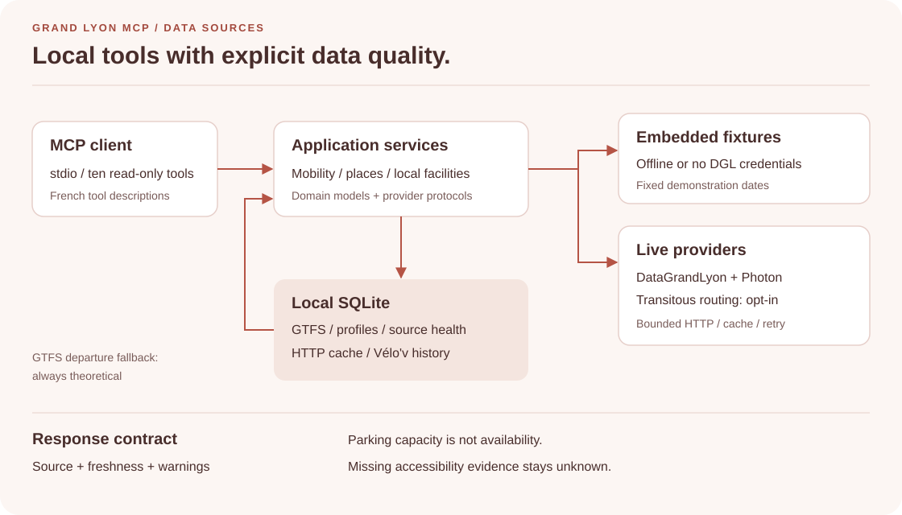

# grand-lyon-mcp

[](https://github.com/ThomasCrouzet/mcp-grand-lyon/actions/workflows/ci.yml)
[](LICENSE)
[](go.mod)

Grand Lyon MCP is a local MCP server for Métropole de Lyon open data.
Ten read-only tools provide departures, parking, accessibility, facilities, waste guidance, travel options, and personal briefings.



The native Go binary uses MCP over stdio.
It includes configuration templates, SQLite migrations, schemas, and demonstration fixtures.
It does not require Python, a virtual environment, or a source checkout.

## Install release 0.2.0

Download the archive for your platform from [GitHub Releases](https://github.com/ThomasCrouzet/mcp-grand-lyon/releases).
Download `SHA256SUMS` from the same release.
Verify the archive checksum before extraction.

Release archives support these targets:

| Operating system | Architectures | Format |
| --- | --- | --- |
| Linux | `amd64`, `arm64` | `.tar.gz` |
| macOS | `amd64`, `arm64` | `.tar.gz` |
| Windows | `amd64` | `.zip` |

Archive names use `grand-lyon-mcp_0.2.0_<os>_<architecture>`.

Extract the archive.
Move `grand-lyon-mcp` or `grand-lyon-mcp.exe` to a directory in `PATH`.

Configure a local offline installation:

```bash
grand-lyon-mcp setup --yes --offline
grand-lyon-mcp doctor
grand-lyon-mcp client-config
```

Setup writes user configuration and migrates the local SQLite database.
It also writes `mcp-client.snippet.json` in the configuration directory.
The binary uses embedded fixtures when offline mode is active.

See [MCP clients](docs/mcp-clients.md) for client configuration and live credentials.

## Build from source

Install Go 1.26 or later.
Clone the repository and build the native binary:

```bash
git clone https://github.com/ThomasCrouzet/mcp-grand-lyon.git
cd mcp-grand-lyon
go mod download
make build
./bin/grand-lyon-mcp setup --yes --offline
```

`make build` sets `CGO_ENABLED=0` and writes `bin/grand-lyon-mcp`.
No Python runtime is necessary.

## Connect an MCP client

Generate a client configuration with an absolute binary path:

```bash
grand-lyon-mcp client-config
```

Example:

```json
{
  "mcpServers": {
    "grand-lyon": {
      "command": "/absolute/path/grand-lyon-mcp",
      "args": ["serve", "--transport", "stdio"],
      "env": {
        "GRAND_LYON_MCP_CONFIG_DIR": "/absolute/config/path",
        "GRAND_LYON_MCP_DATA_DIR": "/absolute/data/path",
        "GRAND_LYON_MCP_DB_PATH": "/absolute/data/path/grand_lyon_mcp.db",
        "GRAND_LYON_MCP_OFFLINE": "true"
      }
    }
  }
}
```

Add the generated block to your MCP client.
The server waits for JSON-RPC messages on stdin and writes protocol messages to stdout.

## Tools

| Tool | Purpose |
| --- | --- |
| `lyon_resolve_place` | Resolve an address, stop, or personal place |
| `lyon_next_departures` | Get TCL realtime departures with theoretical GTFS fallback |
| `lyon_mobility_status` | Get transit alerts, accessibility incidents, traffic, and road events |
| `lyon_trip_options` | Compare travel modes |
| `lyon_parking_options` | Find public parking and park-and-ride options |
| `lyon_accessibility_check` | Check available accessibility evidence |
| `lyon_nearby_facilities` | Find nearby facilities |
| `lyon_environment_brief` | Get supported environmental indicators |
| `lyon_waste_dropoff` | Classify waste and find collection facilities |
| `lyon_personal_briefing` | Build a briefing from a local profile |

See [the tool reference](docs/tools.md) for arguments, limits, and result status.
GTFS results are always theoretical.
Missing parking occupancy stays `null`.
Missing accessibility evidence stays `unknown`.

## Configuration and data

The binary reads user configuration from native platform directories:

| Platform | Configuration | Data |
| --- | --- | --- |
| Linux | `$XDG_CONFIG_HOME/grand-lyon-mcp` or `~/.config/grand-lyon-mcp` | `$XDG_DATA_HOME/grand-lyon-mcp` or `~/.local/share/grand-lyon-mcp` |
| macOS | `~/Library/Application Support/grand-lyon-mcp` | Same as configuration |
| Windows | `%APPDATA%\grand-lyon-mcp` | `%LOCALAPPDATA%\grand-lyon-mcp` |

Use `grand-lyon-mcp env --config-dir` to print the resolved configuration directory.
Each command reads `secrets.env` from that directory without shell evaluation.
Nonempty process environment values take precedence.

The Go release keeps the existing configuration variables, YAML files, and SQLite schema.
See [Operations](docs/operations.md) for all supported settings and maintenance commands.
See [Migration from Python](docs/migration-from-python.md) before replacing a prior installation.

## Development and verification

```bash
make quality
```

The quality gate checks formatting, module state, Go diagnostics, race-enabled tests, and known vulnerabilities.
Process-level tests start CLI and MCP child processes outside the checkout.
They retain repeatable local evidence and protocol transcripts.

```bash
make release RELEASE_DIR=/new/external/release-directory
```

The release target builds five archives and `SHA256SUMS`.
The output path must not exist.
See [Testing](docs/testing.md) and [Contributing](CONTRIBUTING.md).

## Limits and privacy

- MCP transport supports stdio only.
- Transitous routing is optional and disabled by default.
- TCL journey duration can be unavailable without Transitous.
- Live environmental indicators are not configured.
- Embedded fixtures have fixed dates and do not show current conditions.
- Offline fixture results include `OFFLINE_FIXTURE` and `degraded=true`.
- Simulated fixture records always use `realtime=false`.
- Profiles, briefings, and Vélo'v history stay in local SQLite storage.
- The application has no telemetry.
- Live geocoding and routing send required places or coordinates to their providers.

## Documentation

- [Architecture](docs/architecture.md)
- [MCP clients](docs/mcp-clients.md)
- [Tool reference](docs/tools.md)
- [Data sources](docs/data-sources.md)
- [Operations](docs/operations.md)
- [Testing](docs/testing.md)
- [Migration from Python](docs/migration-from-python.md)
- [Changelog](CHANGELOG.md), [Security](SECURITY.md), [Attributions](ATTRIBUTIONS.md)

## License

Code uses the [MIT license](LICENSE).
Data has source-specific licenses; see [Attributions](ATTRIBUTIONS.md).
This project is independent of Métropole de Lyon, SYTRAL Mobilités, Keolis-TCL, and JCDecaux.
